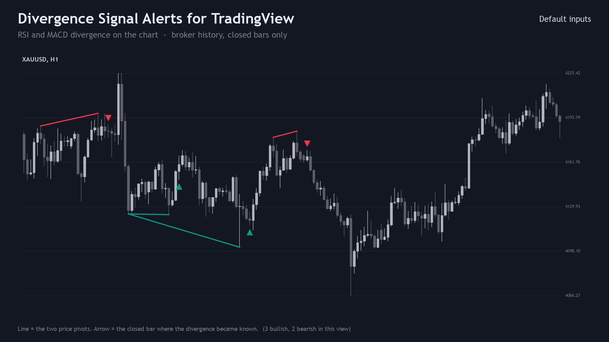
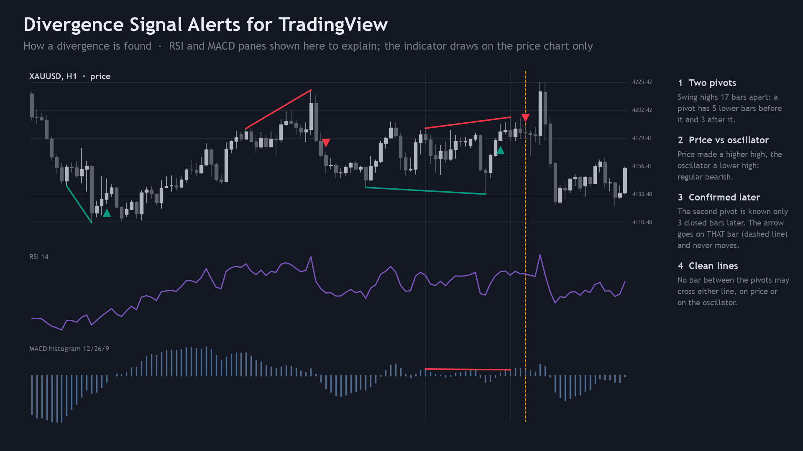
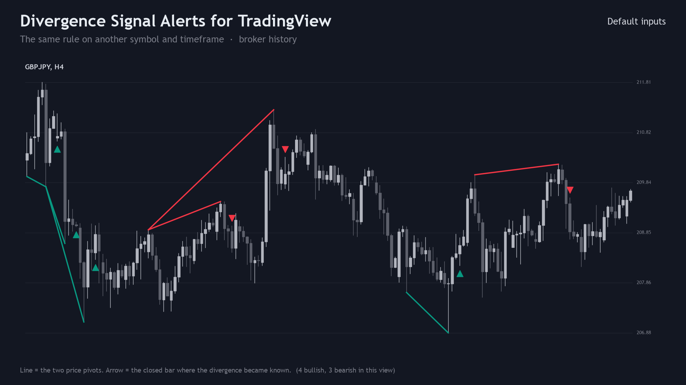
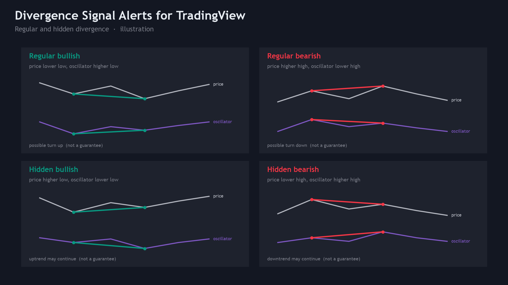
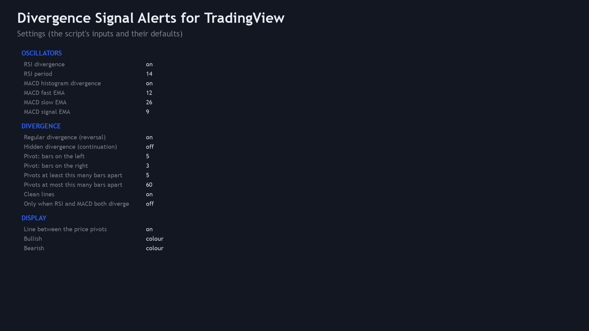
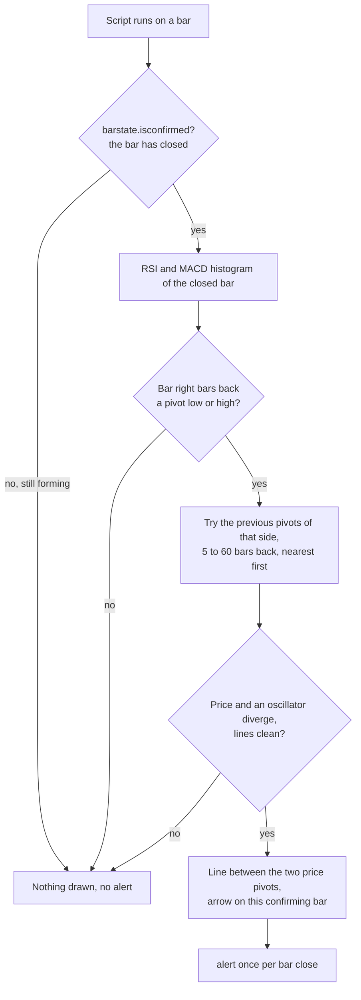

<p align="center"></p>

# Divergence Signal Alerts for TradingView (Pine Script v6)

A free TradingView indicator that finds **RSI and MACD-histogram divergence**, regular and hidden, at swing lows and
highs. It joins the two price pivots with a line and puts an arrow on the bar that confirmed the divergence,
**on closed bars only**, and can send one alert per divergence. Pine Script v6 source, a Python reference of the rule,
and the test that checks the script against the reference bar by bar.

**Website:** [allanninal.dev](https://www.allanninal.dev) · MetaTrader editions: [allanninal.dev/mql5 (indicators)](https://www.allanninal.dev/mql5/#indicators)
· **Contact:** message me on [LinkedIn](https://www.linkedin.com/in/allanninal/).



> It is an indicator, not a strategy. It draws lines and arrows and places no trades. Nothing here is a profit claim
> (see [Honest limits](#honest-limits)).

## Contents

1. [Install in the Pine Editor](#install-in-the-pine-editor)
2. [What it is and who it is for](#what-it-is-and-who-it-is-for)
3. [How it works](#how-it-works)
4. [Non-repainting](#non-repainting)
5. [Inputs and alerts](#inputs-and-alerts)
6. [Tests](#tests)
7. [Honest limits](#honest-limits)
8. [Free vs Pro](#free-vs-pro)
9. [Licence](#licence)

## Install in the Pine Editor

Works on every TradingView plan, including the free Basic plan. The script is not published on TradingView; you add it
from this source.

1. Open [`pine/DivergenceSignalAlerts.pine`](pine/DivergenceSignalAlerts.pine) and copy the whole file (the "Raw"
   button, then select all).
2. On a TradingView chart, open the **Pine Editor** tab at the bottom, create a new indicator and replace its text with
   the copied code.
3. Click **Save**, then **Add to chart**. The indicator appears as "Divergence Alerts" and is kept in your own scripts.

To get alerts: right-click the chart, **Add alert**, choose **Divergence Signal Alerts** as the condition and then
either **Any alert() function call** (one message per divergence, naming its kind and oscillators) or **Bullish
divergence** / **Bearish divergence**. Free plans limit how many alerts can be active at once.

## What it is and who it is for

**What:** divergence between price and an oscillator, found by a fixed numeric rule. A green line under two swing lows
and an up arrow mark a bullish divergence; a red line over two swing highs and a down arrow a bearish one. Solid lines
are regular divergence, dashed lines hidden divergence.

**For:** traders who already read divergence and want it found the same way every time, with a definition they can
read and check.

**Not for:** anyone who expects a divergence to predict a reversal. It describes how two series moved between two
pivots.

| | |
|---|---|
|  |  |
|  |  |

Image notes: the charts are drawn from the Python reference on broker price history, which the script matches bar for
bar (see [Tests](#tests)); the oscillator panes in the "how it works" image and the four-kinds sheet are illustrations,
not TradingView captures. The script itself draws on the price chart only.

## How it works

### The oscillators

| Oscillator | Formula |
|---|---|
| RSI (default 14) | Wilder's RSI of the close. The first average gain and loss are the simple means of the first 14 changes, then `avg = (avg x 13 + new) / 14`. `RSI = 100 - 100 / (1 + gain / loss)`; 100 when the loss is 0, 0 when the gain is 0 |
| MACD histogram (12/26/9) | `EMA12(close) - EMA26(close)` minus the 9-period EMA of that line. Each EMA starts as the simple average of its first values, then `EMA = EMA + 2/(n+1) x (x - EMA)` |

The same formulas, in the same order of operations, are used by the MetaTrader editions
([allanninal/divergence-signal-alerts](https://github.com/allanninal/divergence-signal-alerts)).

### The rule

- **Pivot low** at bar `p`: its low is below the lows of the `left` bars before it (default 5) and not above any of the
  `right` bars after it (default 3). It is therefore known `right` bars later, when bar `p + right` closes.
  A **pivot high** mirrors it.
- At a new pivot low `p`, the previous pivot lows `q` (the newest 4 remembered, nearest first) that are 5 to 60 bars
  back are tried in turn:
  - **regular bullish:** `low[p] < low[q]` and `oscillator[p] > oscillator[q]` (price lower low, oscillator higher low);
  - **hidden bullish:** `low[p] > low[q]` and `oscillator[p] < oscillator[q]`.
- **Bearish** mirrors it at pivot highs (regular: price higher high, oscillator lower high; hidden: the opposite).
- **Clean lines** (default on): no bar strictly between `q` and `p` may cross the straight line from `q` to `p`, below
  it for lows, above it for highs, on price and on that oscillator.
- The first `q` where at least one switched-on oscillator diverges (two with "Only when RSI and MACD both diverge") is
  the result. If a bar confirms a bullish divergence, a bearish one on the same bar is not looked for.

### Per-bar flow



### How often it marks

At the default settings the MetaTrader edition (the same rule) marks, per symbol and month on EURUSD, GBPUSD, USDJPY
and XAUUSD from October 2023 to October 2026: about 36 to 43 divergences on M15, 8 to 11 on H1, 2 to 3 on H4 and
fewer than 0.5 on D1. That counts marks only and says nothing about what price does afterwards.

## Non-repainting

- Every divergence, line, arrow and alert is gated by `barstate.isconfirmed`: nothing is decided on the forming bar.
- A pivot is used only after its `right` bars have closed, and the arrow is placed on that confirming bar, never back
  on the pivot. A line is drawn from the past pivot to the newer pivot once, and never moved or deleted.
- Each decision reads only closed bars. No `request.security`, no future bars.
- Alerts use `alert.freq_once_per_bar_close`.

This was tested, not only reasoned about: see [Tests](#tests).

## Inputs and alerts

| Input | Default | Meaning |
|---|---|---|
| RSI divergence, RSI period | on, 14 | Look for divergence on the RSI |
| MACD histogram divergence, MACD fast / slow / signal EMA | on, 12 / 26 / 9 | Look for divergence on the MACD histogram |
| Regular divergence (reversal) | on | Price and oscillator make opposite extremes |
| Hidden divergence (continuation) | off | The opposite pairing |
| Pivot: bars on the left / on the right | 5 / 3 | Pivot size; "right" is also the confirmation delay |
| Pivots at least / at most this many bars apart | 5 / 60 | Distance between the two pivots (left + right + maximum below 160) |
| Clean lines | on | No bar may cross either line between the pivots |
| Only when RSI and MACD both diverge | off | Fewer, stricter marks |
| Line between the price pivots | on | Solid for regular, dashed for hidden. TradingView keeps the latest 500 lines |
| Bullish, Bearish | `#089981`, `#F23645` | Colours (TradingView's own candle colours by default) |

Every input has a tooltip in the settings dialog. Hidden plots in the Data Window give the details of each divergence
(direction, type, oscillator bit mask, how many bars back the older pivot is) and the RSI and MACD histogram values;
the tests read them.

| Alert condition | Message |
|---|---|
| Any alert() function call | `Regular bullish divergence (RSI+MACD) on EURUSD 60` |
| Bullish divergence | `Bullish divergence on {{ticker}} {{interval}}` |
| Bearish divergence | `Bearish divergence on {{ticker}} {{interval}}` |

## Tests

Run on this exact code:

| Check | Result |
|---|---|
| Compile (TradingView's Pine v6 compiler) | 0 errors, 0 warnings |
| Parity: script vs [`tests/reference.py`](tests/reference.py), every bar, 3 input sets | 0 mismatches: 1,133 divergences (defaults), 553 (hidden on, both oscillators required), 4,184 (RSI only, no clean lines, pivots 3/2); 1 exact tie (below) |
| Oscillator values vs the reference | RSI and MACD histogram within 1e-5 of their median size on every bar (the test runtime rounds stored values to 10 decimals; TradingView does not) |
| Repaint: re-run on the series cut at 3 points, closed bars compared with the full run | 0 of 585,552 closed-bar values changed |

The one exact tie: GBPJPY M15, a bar touching the line between two pivots to within 3e-14. The reference (and
TradingView, which compares numbers exactly) calls the line crossed; PineTS treats numbers within 1e-10 as equal and
calls it clean. The test reruns the reference with PineTS's comparison rule and accepts a difference only when that
rerun gives the script's result; any other difference fails.

Data: the latest 5,000 closed bars of EURUSD, GBPJPY, XAUUSD and BTCUSD on M15, H1 and H4 (12 series, broker history).
The script runs locally in [PineTS](https://github.com/LuxAlgo/PineTS), an independent Pine v6 runtime (not TradingView's engine). To repeat it on
your own bars:

```bash
cd tests/runner && npm install && cd ../..          # PineTS (AGPL-3.0), installed for testing only
python3 -m venv .venv && . .venv/bin/activate && pip install -r requirements.txt
python3 tests/check_pine.py <folder of SYMBOL_TF.csv files: time (unix ms), open, high, low, close>
```

It prints the mismatches and exact ties per configuration, the repaint count and `ALL PASS` or `FAIL`. The price
files used for the numbers above are not in this repository (they are broker price data).

## Honest limits

- **A divergence is not a strategy.** No stop-loss, position sizing or exit rules are provided or implied, and the rule
  was not optimised or back-tested for profit. No edge is claimed anywhere.
- **It is late by design.** A pivot needs `right` closed bars after it, so the arrow appears 3 bars (by default) after
  the swing. Lowering "bars on the right" makes it earlier and noisier.
- **The definition is one reading.** Divergence tools differ in pivot size, distances, the clean-line test and the
  oscillator settings, so marks will differ from other scripts.
- **Line cap.** TradingView keeps the latest 500 lines per script; older arrows stay, older lines drop off.
- **Scope of the tests.** PineTS is a separate runtime from TradingView's; the script was compile-checked with
  TradingView's compiler, and its marks were matched in PineTS on the 12 series above. Other symbols, timeframes and
  data feeds are not covered by these numbers.

## Free vs Pro

| | Free: Divergence Signal Alerts | Paid: Divergence Pro |
|---|---|---|
| Oscillators | RSI, MACD histogram | RSI, MACD histogram, Stochastic, CCI, OBV |
| Regular and hidden divergence, lines, arrows, alerts | yes | yes |
| How many oscillators agree, minimum to show, minimum to alert | "both" switch | yes, 1 to 5 |
| Label with the oscillators that agreed | no | yes |
| Table of the latest divergence on several symbols and timeframes | no | yes |
| Closed bars only, no repaint | yes | yes |
| Source | this repository (PolyForm Noncommercial) | delivered to the buyer, personal-use licence |
| Price | free | paid, one-time |

No need to buy the paid script to use this one: the free indicator is complete on its own. Divergence Pro is described
at [allanninal.dev](https://www.allanninal.dev) (page coming soon).

## Licence

Copyright 2026 Allan Niñal (<https://www.allanninal.dev>). Licensed under the
[PolyForm Noncommercial License 1.0.0](LICENSES/PolyForm-Noncommercial-1.0.0.md): source-available, free for personal
and other noncommercial use, not for commercial use. Text: [`LICENSE`](LICENSE). Please do not republish this script on
TradingView or elsewhere as your own. RSI, MACD and divergence are textbook concepts; the code is original. Trading
involves risk; the software is provided as is.

---

**Website:** [allanninal.dev](https://www.allanninal.dev) · [MetaTrader editions](https://www.allanninal.dev/mql5/#indicators)
· Questions: message me on [LinkedIn](https://www.linkedin.com/in/allanninal/).
